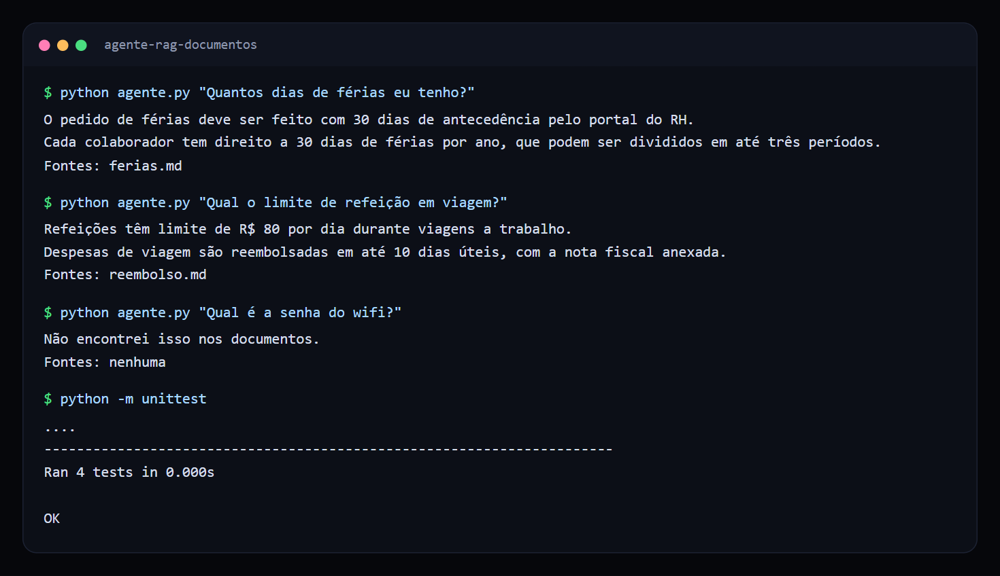
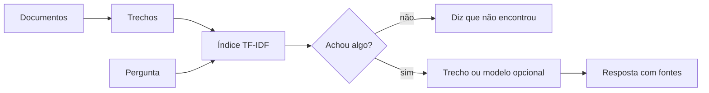

# Agente de perguntas sobre documentos (RAG)

Assistente que responde perguntas com base nos documentos da empresa, cita a fonte de cada resposta e admite quando não sabe.

 

## Veja funcionando



*Respostas com a fonte citada e recusa quando a informação não está nos documentos.*

## O problema

Regras de férias, reembolso e processos internos ficam espalhadas em arquivos que ninguém encontra, e o time acaba perguntando tudo para as mesmas pessoas. Um assistente interno só é útil se der para confiar na resposta. Por isso ele precisa mostrar de onde tirou a informação.

## O que ele faz

- Lê os arquivos Markdown da pasta `documentos/` e divide o conteúdo em trechos.
- Busca os trechos mais relevantes para a pergunta com TF-IDF.
- Devolve a resposta junto com o arquivo de origem.
- Recusa responder quando nada nos documentos sustenta a pergunta.
- Aceita um modelo de linguagem opcional para redigir a resposta a partir dos trechos.

## Como funciona



## Decisões técnicas

| Decisão | Motivo |
| --- | --- |
| TF-IDF no lugar de embeddings | Para poucos documentos é simples, explicável e roda sem serviço externo. A troca fica isolada em `Indice.buscar`. |
| Resposta sempre com fonte | Quem lê consegue conferir a informação. |
| Recusa explícita | É melhor dizer que não sabe do que inventar uma regra interna. |
| Só biblioteca padrão | O projeto roda com qualquer Python 3 instalado. |

## Como rodar

```bash
python agente.py "Quantos dias de férias eu tenho?"
python -m unittest
```

Para usar seus próprios conteúdos, coloque arquivos `.md` na pasta `documentos/`.

## Próximos passos

- Trocar a busca por embeddings quando o volume de documentos crescer.
- Ler também PDF e Word.
- Controlar quem pode ver cada documento.

## Sobre este projeto

Projeto de demonstração, com dados e empresas fictícios, criado para mostrar a abordagem técnica de forma simples.

## Autor

**Luiz Renato Carvalho**, Engenheiro de Software e IA · [luizrenato.dev](https://www.luizrenato.dev) · [LinkedIn](https://linkedin.com/in/luizrenatodc)
